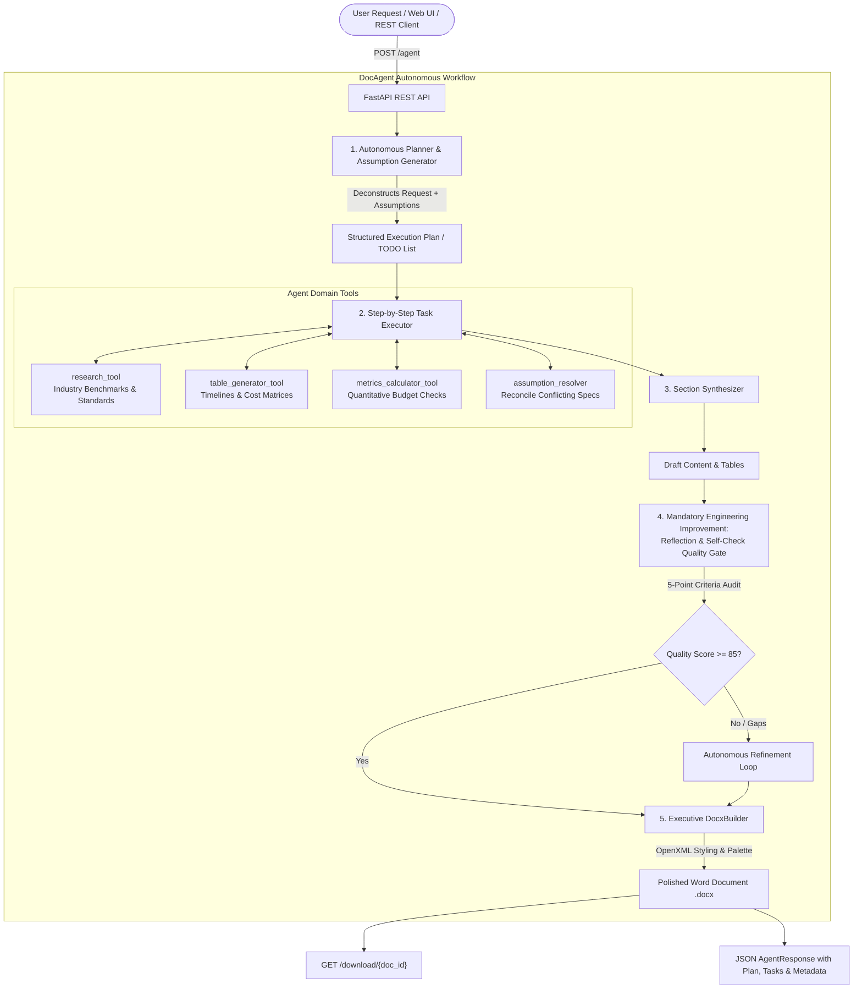

# DocAgent: Autonomous Document-Generating AI Agent

[](https://www.python.org/downloads/)
[](https://fastapi.tiangolo.com)
[](https://docs.pydantic.dev/)
[](https://python-docx.readthedocs.io/)
[](https://opensource.org/licenses/MIT)

> **Python AI Engineer – Autonomous Agents – 60-Minute Build Challenge**  
> An autonomous AI agent system that receives natural language requests, plans and constructs an execution TODO list, resolves ambiguous requirements by formulating explicit assumptions, executes multi-step tool operations, conducts self-reflection quality assurance, and outputs an executive-ready Microsoft Word (`.docx`) document via a FastAPI REST API.

---

## 🏛️ System Architecture



---

## ✨ Key Capabilities

1. **Autonomous Planning Engine**: Decomposes natural language requests into structured, trackable `AgentTask` items (`PENDING` ➔ `RUNNING` ➔ `COMPLETED`).
2. **Explicit Assumption Resolution**: Intelligently identifies missing, ambiguous, or conflicting parameters (e.g. tight budgets vs. competing tech stacks) and generates an explicit **Assumptions Register**.
3. **Mandatory Engineering Improvement (Reflection & Self-Check)**:
   - Evaluates drafts across 5 dimensions: *Constraint Adherence*, *Structure & Completeness*, *Actionability & Depth*, *Executive Tone*, and *Data/Math Consistency*.
   - Automatically triggers self-correction before document rendering if gaps are identified.
4. **Executive Microsoft Word (`.docx`) Generation**:
   - Styled using custom corporate typography and color palettes (Deep Navy `#1B365D` & Slate `#2A6F97`).
   - Title header banner with metadata block (Date, Status, Classification, Audience).
   - Executive Callout boxes with colored left accent borders.
   - Professional data tables with dark header backgrounds, white bold text, alternating row shading (`#F8FAFC`), and XML cell margins.
   - Header & Footer with confidentiality classifications.
5. **Zero-Credit Friction**: Works seamlessly with **Groq** (Llama 3.3 70B), **Google Gemini** (2.5 Flash), and a deterministic **Local Autonomous Reasoning Engine** so you can run and evaluate the system immediately without API credits or rate-limit blocks.
6. **Interactive Demo UI**: Built-in browser console (`http://localhost:8000`) with one-click test case loaders, real-time TODO checklist tracking, and instant `.docx` download.

---

## 🚀 Quickstart & Setup

### 1. Clone & Setup Virtual Environment

```bash
git clone https://github.com/aasthikupadhyay/DocAgent.git
cd DocAgent

# Create and activate virtual environment
python3 -m venv .venv
source .venv/bin/activate  # On Windows: .venv\Scripts\activate

# Install dependencies
pip install -r requirements.txt
```

### 2. Configure Environment (Optional)

```bash
cp .env.example .env
```
*Note: If `GROQ_API_KEY` or `GEMINI_API_KEY` are left blank, DocAgent automatically runs in high-fidelity local autonomous mode.*

### 3. Start the FastAPI Server

```bash
uvicorn app.main:app --reload --port 8000
```

- **Interactive Web Demo**: Open [http://localhost:8000](http://localhost:8000)
- **API Swagger Docs**: Open [http://localhost:8000/docs](http://localhost:8000/docs)
- **Health Endpoint**: Open [http://localhost:8000/health](http://localhost:8000/health)

---

## 🧪 Two Test Cases (Demonstrated in 60-Minute Challenge)

### Test Case 1: Standard Business Request
- **Prompt**:
  ```text
  Create a formal Project Proposal for a Q3 Customer Onboarding Automation system at Acme Corp, including problem statement, proposed solution, timeline, budget, and risk mitigation.
  ```
- **Agent Behavior**:
  - Classifies as *Executive Project Proposal*.
  - Assumes operational target: reduce onboarding time from 28 days to under 7 days with a $35,000 budget cap.
  - Generates 6 execution tasks covering sprint breakdown, cost modeling, narrative, reflection, and document assembly.
  - Passes reflection quality audit (Score: 95/100).
  - Produces a polished `.docx` proposal complete with benchmark comparison tables and sprint allocation grids.

### Test Case 2: Complex, Ambiguous & Conflicting Request
- **Prompt**:
  ```text
  Draft a technical specification and rollout strategy for migrating our legacy monolith to microservices next month, but make sure it handles SOC2 compliance, team capacity constraints, and don't spend more than $50k on cloud infra, even though our CTO wants everything on Kubernetes and our lead architect wants serverless.
  ```
- **Agent Behavior**:
  - Identifies severe conflicting constraints: $50k cloud budget vs. CTO Kubernetes mandate vs. Lead Architect serverless preference.
  - Autonomously formulates **4 explicit assumptions**:
    1. Reconciles tech stack conflict via a **hybrid topology**: persistent core services run on lightweight managed Kubernetes with Spot instances ($47,400/yr), while asynchronous event handlers use serverless functions.
    2. Integrates SOC2 Type II compliance controls into CI/CD pipelines and secret management (HashiCorp Vault) from Phase 1.
    3. Mitigates team burnout by adopting a 3-phase Strangler Fig pattern with rollback gates.
  - Produces a comprehensive technical specification with an **Architectural Tradeoff Matrix** and **Phased Expenditure Roadmap**.

---

## 📡 API Reference

### `POST /agent`
Executes the autonomous agent workflow.

**Request Body**:
```json
{
  "request": "Draft an SOP for Incident Response with escalation matrices and post-mortem procedures.",
  "document_type": null,
  "model_provider": "auto"
}
```

**Response**:
```json
{
  "success": true,
  "request_id": "a1b2c3d4",
  "original_request": "...",
  "execution_summary": "Successfully planned and produced '...' as a Formal SOP...",
  "plan": {
    "document_title": "Enterprise Incident Management & Escalation SOP",
    "document_type": "Standard Operating Procedure",
    "target_audience": "DevOps & Engineering Leadership",
    "assumptions_made": [...],
    "tasks": [
      {
        "id": 1,
        "title": "Deconstruct Incident Severity Levels",
        "description": "...",
        "tool": "research_tool",
        "status": "COMPLETED",
        "output": "...",
        "execution_time_ms": 12
      }
    ]
  },
  "reflection_report": {
    "score": 95,
    "passed": true,
    "checks": [
      {"name": "Constraint Adherence", "passed": true, "details": "..."},
      {"name": "Data & Math Consistency", "passed": true, "details": "..."}
    ],
    "critique": "Draft thoroughly meets all quality rubrics.",
    "revisions_triggered": false
  },
  "document": {
    "doc_id": "a1b2c3d4",
    "filename": "Enterprise_Incident_Management_a1b2c3d4.docx",
    "file_size_bytes": 41820,
    "download_url": "/download/a1b2c3d4",
    "total_sections": 24,
    "total_tables": 5
  },
  "active_provider": "FallbackLLMClient"
}
```

### `GET /download/{doc_id}`
Streams the generated Word document directly to the client with `Content-Type: application/vnd.openxmlformats-officedocument.wordprocessingml.document`.

---

## 🔬 Running Automated Tests

Run the full automated test suite verifying planners, tools, reflection self-check, Word document formatting, and API endpoints:

```bash
source .venv/bin/activate
pytest -v
```

Output:
```text
tests/test_agent.py::test_planner_creates_tasks_and_assumptions PASSED   [ 12%]
tests/test_agent.py::test_tools_execution PASSED                         [ 25%]
tests/test_agent.py::test_docx_builder_creates_valid_file PASSED         [ 37%]
tests/test_agent.py::test_doc_agent_end_to_end_standard PASSED           [ 50%]
tests/test_api.py::test_health_endpoint PASSED                           [ 62%]
tests/test_api.py::test_demo_page_serves_html PASSED                     [ 75%]
tests/test_api.py::test_post_agent_standard_proposal PASSED              [ 87%]
tests/test_api.py::test_post_agent_complex_case PASSED                   [100%]
========================= 8 passed in 0.28s =========================
```

---

## 🎥 Video Presentation Script

A complete, word-for-word 8–10 minute presentation guide is available in [`VIDEO_SCRIPT.md`](VIDEO_SCRIPT.md) covering:
- **Live Demo (3–4 min)**: Demonstrating both test cases in the UI and opening the generated Word documents.
- **What You Built (2–3 min)**: Technical architecture, tools, planning, and python-docx OpenXML styling.
- **Debugging Insight (1–2 min)**: Role-intent collision in multi-stage prompt dispatch and how it was resolved.
- **Tradeoff Discussion (1–2 min)**: Autonomous Planning vs. Deterministic Workflow pipelines.

---

## 📁 Repository Structure

```
DocAgent/
├── app/
│   ├── __init__.py
│   ├── main.py                  # FastAPI server, endpoints, CORS
│   ├── config.py                # Environment configs & paths
│   ├── agent/
│   │   ├── __init__.py
│   │   ├── core.py              # DocAgent main workflow orchestrator
│   │   ├── planner.py           # Autonomous task list generator & assumption resolver
│   │   ├── executor.py          # Step-by-step task runner & tool dispatcher
│   │   ├── reflection.py        # Mandatory Engineering Improvement: Quality audit
│   │   └── tools.py             # Agent tools (research, tables, math, assumptions)
│   ├── llm/
│   │   ├── __init__.py
│   │   ├── client.py            # Unified LLM provider (Groq, Gemini, Fallback)
│   │   └── prompts.py           # Multi-stage system prompts
│   ├── document/
│   │   ├── __init__.py
│   │   └── builder.py           # python-docx styling & OpenXML manipulation
│   ├── models/
│   │   ├── __init__.py
│   │   └── schemas.py           # Pydantic v2 schemas
│   └── static/
│       └── index.html           # Interactive web demo interface
├── tests/
│   ├── __init__.py
│   ├── test_agent.py            # Unit tests for agent reasoning & docx
│   └── test_api.py              # Integration tests for FastAPI endpoints
├── generated_docs/              # Storage directory for output .docx files
├── VIDEO_SCRIPT.md              # 8-10 minute presentation script
├── requirements.txt             # Project dependencies
├── pytest.ini                   # Pytest configuration
├── .env.example                 # Example environment variables
└── README.md                    # System documentation
```
